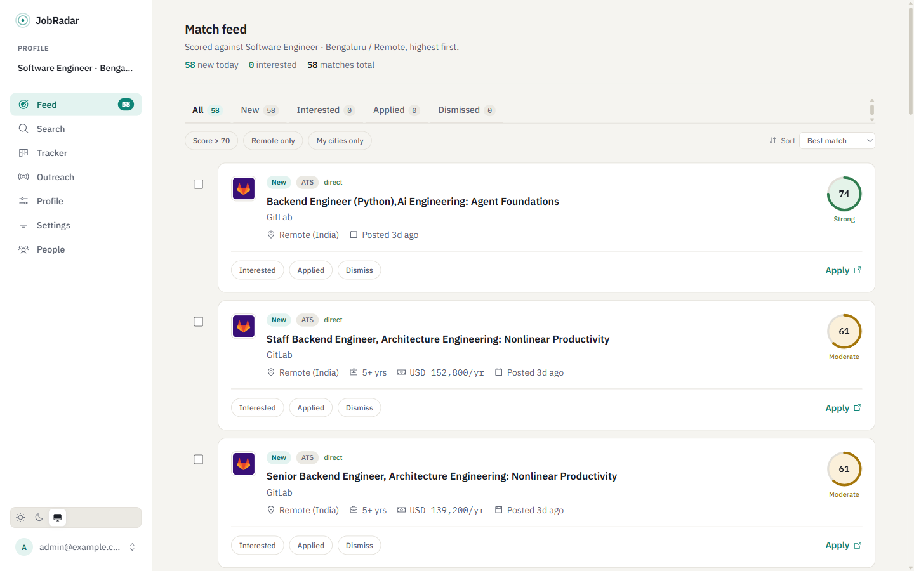
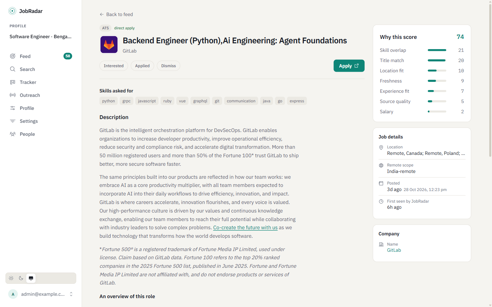

# JobRadar

**A self-hosted job radar for Indian software engineers.** JobRadar pulls IT jobs from nine sources (including Indian boards no other open-source tool covers), removes cross-posted duplicates, scores every job against *your* profile with an explainable 0–100 score, and tracks your applications. It runs on free tiers, so it costs **₹0/month**.

> Job boards show you everything. JobRadar shows you the 20 jobs worth your morning, and why.



<details>
<summary>Job page with the score breakdown</summary>


</details>

## Why

- **Indian sources, deduplicated.** Instahyre, Hirist, Indeed India, LinkedIn, and companies' own Greenhouse/Lever/Ashby boards. The same posting on four sites shows up once, with the best apply link (the company's ATS wins).
- **An explainable score, not a black box.** Every match shows its breakdown: skills 35, title 20, experience 15, location 10, freshness 10, salary 5, source quality 5. India-specific noise is penalised: staffing/C2H listings, "stack spam" job descriptions, ghost reposts, mandatory-CS-degree filters.
- **Your geography.** Onsite cities, hybrid-acceptable metros, and India-eligible remote roles. US-only "remote" jobs are filtered out.
- **The company list grows itself.** When any source mentions a company, JobRadar probes for its public ATS board and polls it directly from then on.
- **Built for the application grind.** Kanban tracker with follow-up reminders, an application packet (tailored summary, pre-filled answers, recruiter contact), and paced outreach email sent from your own Gmail, with reply and bounce tracking over IMAP.
- **Optional AI.** Add a free Gemini key to re-rank your top matches with a one-line "why this fits you" and to draft follow-ups. Without a key, everything still works on the rule-based scoring.
- **Never auto-applies.** You review and press send, always.

## Quick start (Docker)

```bash
git clone https://github.com/Navaneet-Butani/jobradar && cd jobradar
cp .env.example .env    # set SECRET_KEY (see the comment in the file)
docker compose up -d --build

# one-time setup
docker compose exec api python -m scripts.create_admin --email you@example.com --name "Your Name"
docker compose exec api python -m scripts.seed_companies

# pull jobs (these sources need no API keys), then open http://localhost:3000
docker compose exec api python -m scripts.run_ingest --sources ats,hirist,remotive,himalayas
```

Log in, open **Profile**, and set your years of experience, skills, target titles and cities. The next ingest searches for exactly those, and the feed ranks against them. Run `python -m scripts.run_matching` to re-score existing jobs right away. Want to see the app first? `python -m scripts.seed_demo` creates a demo account with two example profiles.

<details>
<summary>Without Docker (Python 3.12 + Node 22 + PostgreSQL)</summary>

```bash
python3.12 -m venv venv && source venv/bin/activate   # Windows: venv\Scripts\activate
pip install -r requirements.txt
cp .env.example .env                                  # point DATABASE_URL at your Postgres
alembic upgrade head
python -m scripts.create_admin --email you@example.com
uvicorn app.main:app --reload --port 8000             # API docs at /docs

cd web && npm ci && npm run dev                       # http://localhost:3000
```

Use Python 3.12, not 3.13+: pinned `asyncpg`/`pandas` builds have no wheels for newer versions.
</details>

## Deploy for ₹0/month

| Piece | Free service |
|---|---|
| Database | Supabase (500 MB; retention jobs keep you inside it) |
| Scheduled ingest, matching, digests | GitHub Actions (no always-on worker needed) |
| API | Render free web service (`render.yaml` included) |
| Web | Vercel hobby |
| Email (optional) | Resend free tier, or any SMTP server |
| AI (optional) | Gemini Flash free tier |

Step-by-step: **[docs/self-hosting.md](docs/self-hosting.md)**.

## Sources

| Source | What | Notes |
|---|---|---|
| ATS boards (Greenhouse, Lever, Ashby) | Company career pages, directly | Highest quality; auto-discovered |
| Instahyre | Indian tech jobs | Search API; no descriptions published |
| Hirist | Indian tech jobs | Descriptions backfilled from the detail API |
| Indeed India (via JobSpy) | Broad coverage | Searched by your cities × titles |
| LinkedIn (guest pages) | Broad coverage | Small, rate-limited budget per run |
| Remotive, Himalayas, Arbeitnow, RemoteOK | Remote boards | Filtered to India-eligible remote |

Naukri and HiringCafe are not supported: both require defeating anti-bot protection. Details in [docs/sources.md](docs/sources.md).

## How it works

```
sources ──> JobProcessor (extract → normalise salary/location/skills/experience
            → dedupe → company resolution → store raw payload) ──> Postgres
                                                                    │
           matching: hard filters → weighted score → noise rules → optional LLM re-rank
                                                                    │
                          FastAPI ──> Next.js (feed · search · tracker · outreach)
```

Ingest and serving are decoupled: the web app only reads the database, so a broken scraper never slows a page. More in [docs/architecture.md](docs/architecture.md).

## Contributing

The most valuable contributions are small:

- **Add companies** to [`data/companies.csv`](data/companies.csv), ideally with their Greenhouse/Lever/Ashby slug. Every row improves everyone's coverage.
- **Add a source.** Most sources are a config block, not a parser: see [docs/adding-a-source.md](docs/adding-a-source.md).
- **Improve matching rules**, with a test in `tests/`.

See [CONTRIBUTING.md](CONTRIBUTING.md).

## Responsible use

JobRadar collects public job postings for personal job search. It never scrapes personal profiles and never submits applications. Some sources' terms restrict automated access. Enable only the sources you are comfortable using, keep request rates low (built-in rate limiters are on by default), and respect each site's terms. You are responsible for how you run it.

## License

[MIT](LICENSE)
